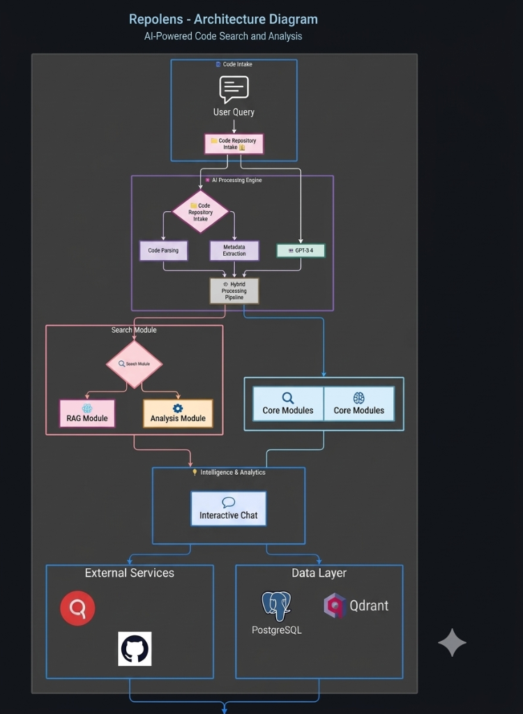

# RepoLens — AI Code Search Assistant

> **Semantic code intelligence for any GitHub repository or ZIP upload.**
> Ask questions, find bugs, suggest features, optimize code, and audit for vulnerabilities — all powered by vector search and an LLM pipeline.

---

## Table of Contents

1. [Why RepoLens?](#-why-repolens)
2. [Features](#-features)
3. [Architecture](#-architecture)
4. [How the App Works](#-how-the-app-works)
5. [Tech Stack](#-tech-stack)
6. [Prerequisites](#-prerequisites)
7. [Installation & Setup](#-installation--setup)
8. [Environment Variables](#-environment-variables)
9. [Running the App](#-running-the-app)
10. [Evaluation Framework](#-evaluation-framework)
11. [Project Structure](#-project-structure)
12. [Testing](#-testing)

---

## 🚀 Why RepoLens?

Modern codebases are too large to grep, too complex to manually review, and too dynamic for static documentation to stay current. RepoLens bridges that gap by:

- **Understanding intent** — it knows whether you want to *find*, *fix*.
- **Searching semantically** — exact keyword matches miss synonyms and related concepts; vector search does not.
- **Generating grounded answers** — every response is anchored to real code chunks retrieved from your repo, not hallucinated.
- **Running offline** — bring your own GitHub repo or upload a ZIP; no external code indexing service required.
- **Staying evaluable** — a built-in evaluation framework lets you measure and track retrieval and intent quality over time.

---

## ✨ Features

| Feature | Description |
|---|---|
| **Semantic Code Search** | Hybrid dense + sparse vector search over code chunks stored in Qdrant |
| **Intent Classification** | Automatically classifies queries into 6 intents: `RETRIEVE`, `ADD_FEATURE`, `FIX_BUG`, 'FIX_VULNERABILITY` |
| **GitHub Integration** | Index any public or private GitHub repository via URL; auto-update via webhooks on push |
| **ZIP Upload** | Upload a local repository as a ZIP archive for offline or private repo analysis |
| **Vulnerability Scanning** | Dedicated pipeline stage for security analysis with LLM-assisted remediation suggestions |
| **React Frontend** | Clean, responsive UI with search, repository management, upload, and job monitoring pages |

---

## 🏗 Architecture



The diagram shows the major components and how repository ingestion, search, and vulnerability analysis use the API, workers, databases, and AI integrations.

### Data Flow

```
User Query
    │
    ▼
Intent Classification  ────► RETRIEVE / FIX_BUG / ADD_FEATURE
    │                          FIX_VULNERABILITY
    ▼
Code Retrieval  (Qdrant hybrid search)
    │
    ▼
Evidence Validation  (filter low-quality chunks)
    │
    ▼
Context Builder  (assemble prompt context)
    │
    ├── RETRIEVE          → Response Generation (direct answer)
    ├── FIX_BUG           → Code Analysis → Patch → Remediation Verification
    └── FIX_VULNERABILITY → Vulnerability Orchestration → Remediation Verification
    │
    ▼
Structured JSON Response → Frontend rendering
```

---

## ⚙️ How the App Works

### 1. Repository Ingestion

**GitHub repos:**
Submit a repo URL → the backend fetches files via the GitHub API → files are filtered by language and size → code is parsed into AST-aware chunks → chunks are embedded using Jina AI → vectors are upserted into a per-repository Qdrant collection.

**ZIP upload:**
Upload a `.zip` → backend extracts, filters, chunks, embeds, and upserts the same way — no GitHub token required.

**Webhooks:**
Register a GitHub webhook → on every push, changed files are re-ingested incrementally using SHA-based checkpointing (only modified or deleted files are re-processed).

### 2. Search & Query Answering

1. **Query preprocessing** — normalises whitespace, expands abbreviations.
2. **Intent classification** — routes the query to one of 6 intents using the LLM.
3. **Collection selection** — picks the correct Qdrant collection for the target repository.
4. **Hybrid retrieval** — combines dense (semantic) and sparse (keyword) vectors, returning top-K chunks.
6. **Response generation** — LLM synthesizes a grounded answer from the validated chunks.


.

---

## 🛠 Tech Stack

### Backend

| Layer | Technology |
|---|---|
| Web framework | FastAPI + Uvicorn |
| Database | PostgreSQL + SQLAlchemy (async) + Alembic |
| Vector store | Qdrant |
| Embeddings | Jina AI `jina-embeddings-v3` (1024-dim) |
| LLM | Qwen `qwen-plus` (DashScope, OpenAI-compatible API) |
| Code chunking | AST-aware chunker (Python, JS, TS, and more) |
| Language | Python 3.11+ |

### Frontend

| Layer | Technology |
|---|---|
| Framework | React 19 + TypeScript |
| Build tool | Vite 8 |
| UI library | MUI (Material UI) v9 |
| HTTP client | Axios |
| Markdown | react-markdown + react-syntax-highlighter |
| Routing | React Router v7 |

---

## 📋 Prerequisites

- **Python 3.11+**
- **Node.js 18+** and npm
- **PostgreSQL 14+**
- **Qdrant** (Docker or Qdrant Cloud)
- **Jina AI API key** — [console.jina.ai](https://console.jina.ai)
- **GitHub Personal Access Token** (optional, for private repos and webhooks)


## 🔧 Installation & Setup

### 1. Clone the repository

```bash
git clone https://github.com/your-org/repolens.git
cd repolens/code-assistant
```

### 2. Backend setup

```bash
cd backend

# Create and activate virtual environment
python -m venv venv

# Windows
venv\Scripts\activate
# macOS / Linux
source venv/bin/activate

# Install dependencies
pip install -r requirements.txt
```

### 3. Configure environment variables

```bash
cp .env.example .env
# Open .env and fill in all required values
```

### 4. Run database migrations

```bash
alembic upgrade head
```

### 5. Frontend setup

```bash
cd ../frontend
npm install
```

---

## 🌍 Environment Variables

| Variable | Description | Required |
|---|---|---|
| `DATABASE_URL` | PostgreSQL connection string | ✅ |
| `QDRANT_URL` | Qdrant URL (default: `http://localhost:6333`) | ✅ |
| `JINA_API_KEY` | Jina AI API key for embeddings | ✅ |
| `GITHUB_TOKEN` | GitHub Personal Access Token | Private repos |
| `GITHUB_WEBHOOK_SECRET` | Shared secret for webhook HMAC validation | Webhooks |
| `APP_BASE_URL` | Publicly reachable URL for webhook callbacks | Webhooks |

See `backend/.env.example` for the full list with defaults and descriptions.

---

## ▶️ Running the App

### Backend API

```bash
cd backend
uvicorn app.main:app --host 0.0.0.0 --port 8000 --reload
```

API docs: [http://localhost:8000/docs](http://localhost:8000/docs)


### Frontend

```bash
cd frontend
npm run dev
```

Frontend: [http://localhost:5173](http://localhost:5173)

---

## 📊 Evaluation Framework

`backend/evaluation/` is a standalone module for measuring retrieval and intent quality — completely separate from production code.


### Run evaluation

```bash
cd backend


---


---

## 🧪 Testing

`
p
